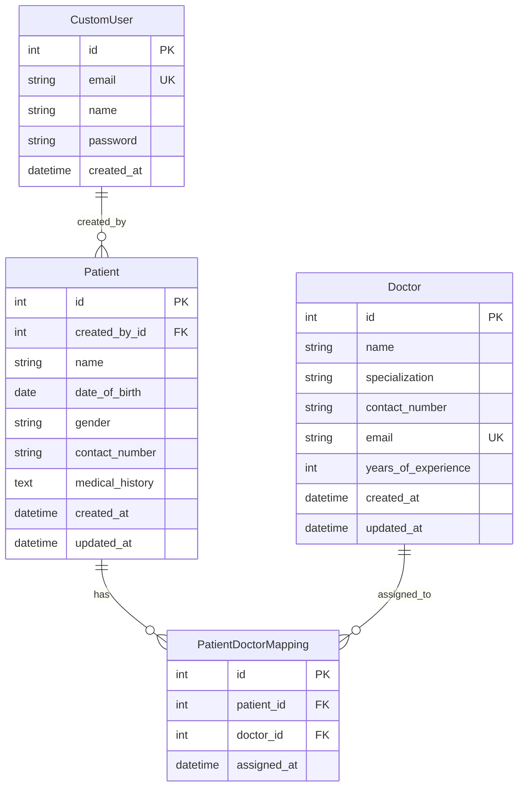

# Healthcare Backend System API

A secure, production-grade backend system for a healthcare application built with **Django**, **Django REST Framework (DRF)**, **PostgreSQL** (hosted via Supabase), and **SimpleJWT** for stateless authentication.

---

## Features

- **Custom Email-Based Authentication**: Registration, Login, and Token Refresh using `djangorestframework-simplejwt`.
- **Patient Management (CRUD)**: Strict data isolation — users can only view and manage patients they personally created.
- **Doctor Management (CRUD)**: Complete doctor catalog with specialty, experience, and contact management.
- **Patient-Doctor Mapping**: Assign doctors to patients, prevent duplicate assignments, query all doctors per patient, and unassign doctors.
- **Standardized Error Handling**: Unified JSON response structure across validation errors, 401s, 403s, and 404s.
- **PostgreSQL Database**: Backed by Supabase PostgreSQL via connection pooling.
- **Comprehensive Test Suite**: 24 automated unit and integration tests passing with 100% success rate.
- **Postman Ready**: Includes pre-configured Postman Collection & Environment with auto-token capture.

---

## Technology Stack

- **Framework**: Django 4.2 LTS, Django REST Framework 3.17
- **Authentication**: `djangorestframework-simplejwt` (HS256)
- **Database**: PostgreSQL (via `psycopg2-binary`)
- **Environment Management**: `python-dotenv`
- **CORS Handling**: `django-cors-headers`

---

## Database Architecture (ER Diagram)



---

## API Endpoints Reference

### 1. Authentication APIs
| Method | Endpoint | Description | Auth Required |
|---|---|---|---|
| `POST` | `/api/auth/register/` | Register user with `name`, `email`, `password`, `password2` | No |
| `POST` | `/api/auth/login/` | Authenticate with `email` + `password`; returns JWT tokens | No |
| `POST` | `/api/auth/token/refresh/` | Obtain a new access token using `refresh` token | No |

### 2. Patient Management APIs
| Method | Endpoint | Description | Auth Required |
|---|---|---|---|
| `POST` | `/api/patients/` | Add a new patient (auto-associated with user) | **Yes** (JWT) |
| `GET` | `/api/patients/` | Retrieve all patients created by the authenticated user | **Yes** (JWT) |
| `GET` | `/api/patients/<id>/` | Get details of a specific patient | **Yes** (JWT) |
| `PUT` | `/api/patients/<id>/` | Update all patient details | **Yes** (JWT) |
| `PATCH` | `/api/patients/<id>/` | Partial update of patient details | **Yes** (JWT) |
| `DELETE` | `/api/patients/<id>/` | Delete a patient record | **Yes** (JWT) |

### 3. Doctor Management APIs
| Method | Endpoint | Description | Auth Required |
|---|---|---|---|
| `POST` | `/api/doctors/` | Add a new doctor | **Yes** (JWT) |
| `GET` | `/api/doctors/` | Retrieve all doctors | **Yes** (JWT) |
| `GET` | `/api/doctors/<id>/` | Get details of a specific doctor | **Yes** (JWT) |
| `PUT` | `/api/doctors/<id>/` | Update doctor details | **Yes** (JWT) |
| `PATCH` | `/api/doctors/<id>/` | Partial update of doctor details | **Yes** (JWT) |
| `DELETE` | `/api/doctors/<id>/` | Delete a doctor record | **Yes** (JWT) |

### 4. Patient-Doctor Mapping APIs
| Method | Endpoint | Description | Auth Required |
|---|---|---|---|
| `POST` | `/api/mappings/` | Assign doctor to patient (`patient_id`, `doctor_id`) | **Yes** (JWT) |
| `GET` | `/api/mappings/` | Retrieve all patient-doctor mappings | **Yes** (JWT) |
| `GET` | `/api/mappings/<patient_id>/` | Get all doctors assigned to a specific patient | **Yes** (JWT) |
| `DELETE` | `/api/mappings/<id>/` | Remove doctor from patient by mapping ID | **Yes** (JWT) |

---

## Installation & Local Setup

### 1. Clone repository & Navigate to project:
```bash
git clone <repo-url>
cd healthcare-backend
```

### 2. Create and Activate Virtual Environment:
```bash
# Windows
python -m venv venv
.\venv\Scripts\activate

# Linux / macOS
python3 -m venv venv
source venv/bin/activate
```

### 3. Install Dependencies:
```bash
pip install -r requirements.txt
```

### 4. Configure Environment Variables:
Create a `.env` file in the root directory:
```env
SECRET_KEY=your-django-secret-key-here
DEBUG=True
ALLOWED_HOSTS=localhost,127.0.0.1

DB_NAME=postgres
DB_USER=postgres.<project-ref>
DB_PASSWORD=<your-db-password>
DB_HOST=aws-0-<region>.pooler.supabase.com
DB_PORT=5432
```

### 5. Apply Migrations:
```bash
python manage.py makemigrations
python manage.py migrate
```

### 6. Run the Development Server:
```bash
python manage.py runserver
```
The API is now live at `http://127.0.0.1:8000/`.

---

## Running the Automated Test Suite

To run all 24 automated unit and integration tests across all modules:
```bash
python manage.py test accounts patients doctors mappings --verbosity=2
```

Expected output:
```
Ran 24 tests in 70.460s

OK
```

---

## Testing with Postman

1. Open Postman.
2. Click **Import** and select:
   - `Healthcare_API_Postman_Collection.json`
   - `Healthcare_API_Postman_Environment.json`
3. Select the imported environment **Healthcare API Environment (Local)** in the top right.
4. Execute `1. Authentication -> Login (Obtain JWT)`:
   - The test script **automatically saves** the `access_token` into the environment.
5. All subsequent requests in the `Patients`, `Doctors`, and `Mappings` folders use `Bearer {{access_token}}` automatically.

---

## Project Structure

```
├── accounts/                  # CustomUser model, Auth Serializers, Login/Register Views
│   ├── models.py              # CustomUser with email-based authentication
│   ├── serializers.py         # RegisterSerializer, UserSerializer, TokenSerializer
│   ├── views.py               # RegisterView, LoginView
│   ├── urls.py                # /api/auth/ routes
│   ├── tests.py               # 6 Auth unit tests
│   └── admin.py               # Custom UserAdmin
├── patients/                  # Patient CRUD & Data Isolation
│   ├── models.py              # Patient model with user ForeignKey (created_by)
│   ├── serializers.py         # PatientSerializer with phone regex validation
│   ├── views.py               # PatientViewSet with get_queryset() data isolation
│   ├── urls.py                # /api/patients/ router
│   ├── tests.py               # 6 Patient tests (CRUD + user isolation)
│   └── admin.py
├── doctors/                   # Doctor CRUD catalog
│   ├── models.py              # Doctor model (specialization, experience, contact)
│   ├── serializers.py         # DoctorSerializer with experience >= 0 check
│   ├── views.py               # DoctorViewSet
│   ├── urls.py                # /api/doctors/ router
│   ├── tests.py               # 7 Doctor tests (CRUD + validations)
│   └── admin.py
├── mappings/                  # Patient-Doctor relationships
│   ├── models.py              # PatientDoctorMapping with unique_together constraint
│   ├── serializers.py         # Validation for duplicate and ownership
│   ├── views.py               # Mapping views (list, create, detail by patient_id)
│   ├── urls.py                # /api/mappings/ routes
│   ├── tests.py               # 5 Mapping tests (assignment, duplicates, delete)
│   └── admin.py
├── healthcare_project/        # Root configuration
│   ├── settings.py            # SimpleJWT, DRF, Database, CORS, Middleware
│   ├── urls.py                # Root router including all 4 app paths
│   └── exceptions.py          # Unified JSON error response handler
├── .env                       # Environment secrets (database, secret key)
├── requirements.txt           # Pinned Python package dependencies
├── Healthcare_API_Postman_Collection.json   # Ready-to-import Postman collection
└── Healthcare_API_Postman_Environment.json  # Postman environment with dynamic variables
```
